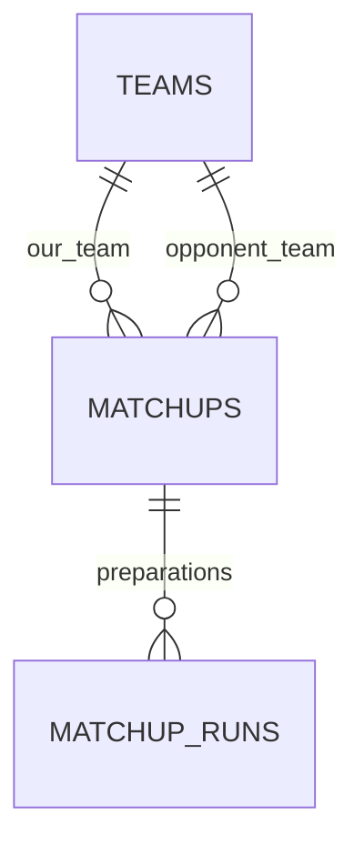

# Plan 2 — Modèle SQL des équipes et des préparations de matchup

> **For agentic workers:** REQUIRED SUB-SKILL: Use superpowers:executing-plans to implement this plan task-by-task. Steps use checkbox (`- [ ]`) syntax for tracking.

**Goal:** Persister équipes, matchups et versions de préparation dans PostgreSQL, en conservant les informations déjà affichées par Angular.

**Architecture:** Trois tables relationnelles `core.teams`, `core.matchups`, `core.matchup_runs`. Les six Pokémon et les rapports détaillés sont des documents JSONB versionnés ; les relations, statuts et métadonnées interrogeables restent des colonnes SQL. Une nouvelle analyse crée une nouvelle préparation sans écraser le rapport précédent.

**Tech Stack:** PostgreSQL 17, SQL/PLpgSQL, Flyway, annotations PostGraphile v4.

**Spec:** [Cadrage](./README.md), [plan 1](./2026-10-31-01-conception-flyway.md), modèles réels [Team](../../../pokecoach2-angular/pokecoach-angular/src/app/core/models/team.model.ts) et [MatchupReport](../../../pokecoach2-angular/pokecoach-angular/src/app/core/models/matchup.model.ts), [synthèse métier](../../../synthese_projet_vgc_matchup_coach.md).

## Contraintes globales

- Prérequis : plan 1 terminé. Chemins relatifs à `pokecoach2-conception/`.
- Aucun code Angular/Python modifié ; pas de migration automatique du `localStorage` actuel.
- Aucun schéma documentaire `kb/docx`, catalogue LLM, moteur de win condition ou stockage objet. MinIO et toute référence S3 sont exclus.
- Pas de tables pour chaque capacité, tour et statistique avant l’audit VGC-Bench ; conserver le rapport structuré sous une enveloppe versionnée.
- UUID pour les nouvelles identités SQL. Les fixtures Angular utilisent aussi des IDs tels que `demo-matchup-1` : elles nécessitent une table de correspondance lors de leur conversion, pas un cast UUID.
- Une équipe adverse ne doit pas apparaître dans la liste de nos équipes ; chaque matchup a une seule équipe de chaque côté.

## Points de revue

| Cas | Vérification |
| --- | --- |
| JSON null/invalide ou six slots incohérents | Tâche 1 : validations SQL négatives |
| Adversaire listé comme notre équipe / relation inversée | Tâche 2 : rôles d’équipes et FKs |
| Équipe modifiée après une analyse | Tâche 2 : instantanés inchangés sur les préparations existantes |
| Rapport failed présenté comme résultat terminé | Tâche 3 : statut, rapport et sélection du dernier succès |
| Insertion GraphQL contournant les droits et l’audit | Tâche 4 : tests avec `SET ROLE authenticated_user` |

## Modèle proposé

### `core.teams`

| Colonne | Type / règle |
| --- | --- |
| `id` | `uuid PRIMARY KEY DEFAULT gen_random_uuid()` |
| `kind` | texte contraint : `owned` ou `opponent`, immuable après création |
| `name` | texte non vide après trim |
| `source_kind` | `url` ou `text` |
| `source_url` | texte nullable ; obligatoire pour `url`, HTTPS Poképaste ; peut rester présent comme provenance d’une fixture texte |
| `source_text` | texte Showdown non vide conservé sans perte |
| `pokemon` | tableau JSONB de six objets `PokemonSet` dans l’ordre des slots |
| `data_version` | entier positif, initialement `1` |
| audit | `created_at`, `updated_at` en timestamptz ; `created_by`, `updated_by` texte |
| `is_deleted` | booléen faux par défaut, archivage logique |

Chaque `PokemonSet` conserve `slot`, `species`, `nickname`, `gender`, `item`, `ability`, `level`, `teraType`, `nature`, `evs`, `ivs`, `moves`, `rawBlock` selon leur présence. Ne pas renommer les propriétés imbriquées au passage SQL. Les tableaux de moves restent ordonnés. Valider la structure, pas la légalité VGC.

### `core.matchups`

| Colonne | Type / règle |
| --- | --- |
| `id` | UUID PK |
| `our_team_id` | FK non nulle vers `teams`, dont `kind = owned` |
| `opponent_team_id` | FK non nulle vers `teams`, dont `kind = opponent` |
| `regulation` | texte nullable tant que l’utilisateur ne la renseigne pas |
| audit et `is_deleted` | mêmes conventions que `teams` |

Les deux FK sont distinctes, indexées et en `ON DELETE RESTRICT`. Les associations ne changent pas après création ; un autre duel produit un autre matchup. Ne pas ajouter d’unicité sur les noms ou le couple d’équipes : plusieurs préparations/entrées volontaires sont possibles.

### `core.matchup_runs`

| Colonne | Type / règle |
| --- | --- |
| `id` | UUID PK |
| `matchup_id` | FK non nulle, `ON DELETE RESTRICT` |
| `source` | `mock` ou `simulation` ; aucune vraie simulation n’est créée par ce plan |
| `status` | `queued`, `running`, `succeeded`, `failed`, `cancelled` |
| `our_team_snapshot`, `opponent_team_snapshot` | objets JSONB complets de l’équipe au lancement, structure Team v1 |
| `parameters` | objet JSONB, configuration et effectifs demandés par phase lorsqu’ils sont connus |
| `provenance` | objet JSONB : versions checkpoint/VGC-Bench/Showdown/prompt/LangGraph lorsqu’elles existent ; aucun faux numéro |
| `report_version` | entier positif ; `1` correspond à l’enveloppe actuelle |
| `report` | JSONB nullable : rapport complet actuel, données A–D et synthèse |
| `error_message` | texte nullable, erreur de préparation sans secrets |
| `started_at`, `finished_at` | timestamptz nullables selon le statut |
| audit | mêmes quatre colonnes d’audit |

Les instantanés sont remplis côté SQL à l’insertion à partir des équipes référencées, pas acceptés aveuglément du client. Ils restent immuables ensuite. Toute édition d’équipe ultérieure n’altère pas l’interprétation des slots d’un ancien rapport.

Les paramètres/provenance sont gelés dès que la préparation quitte `queued`. Une préparation terminale est immuable ; relancer crée une nouvelle ligne. Les statuts ne déclenchent aucun worker dans ce plan.



## Fichiers de migration

```text
modules/1.0-core/sql/
  core/V1.0.2__create_teams.sql
  core/V1.0.3__create_matchups.sql
  core/V1.0.4__create_matchup_runs.sql
  trigger_functions/V1.0.5__add_audit_and_integrity_triggers.sql
  core/R__matchup_read_functions.sql
  afterMigrate.sql
tests/sql/010_teams.sql
tests/sql/020_matchups_and_runs.sql
tests/sql/030_privileges.sql
tests/fixtures/demo.sql
scripts/test-db.sh
scripts/seed-demo.sh
docs/data-contract.md
```

Ajouter les profils `*_repoindex.md` à côté des migrations et mettre à jour les deux documents repoindex du plan 1.

## Tâche 1 — Équipes et validation de leurs six Pokémon

**Interfaces SQL :** `core.is_valid_pokemon_sets(jsonb) RETURNS boolean`, `core.teams`.

- [ ] Écrire `010_teams.sql` : six slots 0–5 dans l’ordre acceptés ; cinq/sept entrées, doublons, slot absent, espèce vide, JSON null ou non-tableau rejetés. Tester les types des champs optionnels, `moves` tableau de textes, `evs/ivs` objets de nombres ; ne pas rejeter un Pokémon simplement parce qu’une image n’existe pas.
- [ ] Implémenter une validation JSONB `IMMUTABLE` totale qui renvoie false pour les mauvaises formes sans cast accidentel. Protéger explicitement les valeurs NULL : un `CHECK` évalué à NULL n’est pas une validation réussie. Consulter les [contraintes PostgreSQL](https://www.postgresql.org/docs/17/ddl-constraints.html).
- [ ] Créer `teams` avec les contraintes de source et de structure, et un index utile à la liste `kind`, `is_deleted`, `created_at`, `id`. Ne pas créer d’index GIN sur tout le JSON sans requête justifiant son coût.
- [ ] Vérifier la restitution exacte des accents, surnoms, formes, EV/IV et capacités. Le parsing Poképaste reste une responsabilité du service applicatif déjà existant, pas une fonction SQL à réécrire.
- [ ] Appliquer la migration et exécuter les tests sur une base de test dédiée.

## Tâche 2 — Matchups, historique et instantanés

**Interfaces :** tables `matchups`, `matchup_runs` et triggers d’intégrité/audit du fichier V1.0.5.

- [ ] Créer les deux tables et leurs index, dont `(our_team_id, is_deleted, created_at, id)` et `(matchup_id, status, created_at DESC, id)` pour les préparations.
- [ ] Imposer les rôles des équipes via un trigger de relation et rendre `teams.kind` immuable. Les FK garantissent l’existence ; le trigger interdit l’inversion des côtés et les nouveaux matchups sur des équipes archivées.
- [ ] Lors d’une insertion de run, vérifier que le matchup et ses deux équipes sont actifs, lire les deux équipes et copier leurs structures complètes. Garantir une lecture cohérente des deux côtés dans la transaction ; tester une mise à jour concurrente si les lectures sont faites en plusieurs instructions.
- [ ] Protéger les instantanés, le lien matchup et les champs gelés contre les UPDATE ultérieurs ; rendre les runs terminaux immuables. Autoriser `queued → running/cancelled/failed`, `running → succeeded/failed/cancelled` et, pour l’import mock, `queued → succeeded`.
- [ ] Ajouter des contrôles : succès exige un rapport objet et `finished_at` ; échec exige `error_message` et `finished_at` ; annulation exige `finished_at` ; queued/running ne portent pas de rapport final. Les dates de fin ne précèdent pas le début lorsqu’il est renseigné.
- [ ] Tester rôles inversés, FK manquantes, archived, changement de kind, snapshot falsifié, changement d’équipe après un succès, conservation de deux runs distincts et transitions interdites.

## Tâche 3 — Contrat du rapport et données de démonstration

**Interfaces :** `docs/data-contract.md`, fonction stable `core.matchups_latest_successful_run(core.matchups) RETURNS core.matchup_runs`, fixture SQL explicite.

- [ ] Documenter la correspondance frontend/SQL : `Team` depuis une ligne équipe ; `PreparedMatchup.teamId` depuis `our_team_id`, `opponent` depuis l’instantané adverse du run, `report` depuis `report`, `createdAt` conservé. Pour l’affichage historique, les slots de notre côté se résolvent sur l’instantané et pas sur une équipe potentiellement modifiée.
- [ ] Conserver dans `report` tous les champs actuels : fréquences A/B, actions/cibles/switch, backs, comparaisons C, recommandation, gameplan et séquences D. `source=mock` et `fixtureVersion=1` restent clairement identifiables.
- [ ] Valider pour le rapport mock v1 les clés racines, types principaux, effectifs non négatifs et cohérence de la source ; tester le round-trip complet avec une fixture issue de `buildMockMatchupReport`. Les détails futurs `simulation` exigent une version de contrat documentée, sans prétendre valider dès maintenant toute la stratégie VGC.
- [ ] Fournir la fonction de lecture du dernier succès, ordonnée par `created_at DESC, id DESC`, sans utiliser le dernier échec comme résultat. Elle renvoie NULL si aucun succès n’existe et reste `SECURITY INVOKER`.
- [ ] Préparer une petite fixture SQL contenant deux équipes personnelles, un adversaire et un matchup réussi en mock. Choisir des UUID fixes et documenter la conversion des IDs de démonstration. Une équipe personnelle n’a aucun matchup.
- [ ] Isoler les seeds des migrations de structure : `scripts/seed-demo.sh` explicite, transactionnel et idempotent, refusant d’écraser des lignes existantes différentes. Aucun accès au navigateur de l’utilisateur.
- [ ] Tester seed deux fois, choix du dernier succès malgré un échec plus récent, absence de succès, et restitution JSON sans perte.

## Tâche 4 — Audit, droits et exposition PostGraphile

**Fichiers :** V1.0.5, `afterMigrate.sql`, `030_privileges.sql`, repoindex.

- [ ] Implémenter les triggers d’audit : création/édition horodatées côté DB, acteur issu d’un paramètre de session contrôlé côté serveur, valeur `system` en l’absence d’acteur. Ne pas décoder un token dans SQL ni considérer `created_by` comme une preuve d’identité.
- [ ] Au callback, accorder `USAGE core` et SELECT sur les trois tables à `authenticated_user`. Autoriser l’insertion des colonnes métier de teams/matchups ; UPDATE limité aux colonnes éditables (nom/source/Pokémon/archivage des équipes, archivage du matchup), pas aux identités et relations immuables.
- [ ] Ne pas accorder DELETE ni accès à l’historique Flyway. Les résultats/runs sont en lecture seule pour le rôle API ; le rôle worker possède les droits métier nécessaires sur les runs et la lecture des équipes/matchups, jamais les droits DDL ou la propriété des tables.
- [ ] Ajouter les smart comments : audit et instantanés absents des entrées create/update, tables techniques et fonctions de trigger masquées, mutations de runs cachées. Les [annotations PostGraphile](https://postgraphile.org/postgraphile/4/smart-comments/) complètent les permissions SQL ; elles ne les remplacent pas.
- [ ] Révoquer les accès `PUBLIC` non nécessaires aux fonctions internes ; accorder explicitement l’exécution des helpers nécessaires aux contraintes et de la fonction de lecture. Tester qu’une contrainte reste utilisable sous le rôle API après ces révocations.
- [ ] Exécuter les tests positifs/négatifs sous les rôles réels, y compris modification des champs d’audit, suppression, écriture d’un rapport par l’API et lecture technique.
- [ ] Ajouter `scripts/test-db.sh` : base de test distincte, `psql -v ON_ERROR_STOP=1`, rollback des cas de test et code de sortie non nul si une assertion échoue. Ne jamais lancer les tests destructifs sur la base de travail.
- [ ] Rejouer migrate/validate depuis une base vide et depuis le jalon 1, puis mettre à jour les profils repoindex et le contrat de données.

**Fin du jalon :** données persistables et contraintes testées ; exemples complets accessibles en SQL. Aucun écran n’a changé ; le raccordement frontend et les mutations de préparation via une vraie API restent à implémenter séparément.
