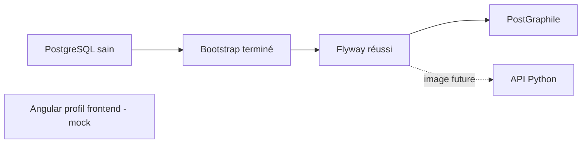

# Plan 3 — Docker Compose pokecoach2 dans le dépôt conception

> **For agentic workers:** REQUIRED SUB-SKILL: Use superpowers:executing-plans to implement this plan task-by-task. Steps use checkbox (`- [ ]`) syntax for tracking.

**Goal:** Compléter le Compose local avec les composants utiles de PerfAO, adaptés à pokecoach2, et documenter leur activation réelle.

**Architecture:** PostgreSQL persistant, bootstrap et migrations à usage unique, puis PostGraphile. Angular est un profil optionnel construit depuis son dossier existant. Python est une extension Compose distincte, activable seulement lorsqu’une image applicative pokecoach2 existe.

**Tech Stack:** Docker Compose v2, PostgreSQL 17, Flyway, PostGraphile v4, build Angular/npm, serveur HTTP statique.

**Spec:** [Cadrage et décision sans MinIO](./README.md), [plan 1](./2026-10-31-01-conception-flyway.md), [plan 2](./2026-10-31-02-modele-donnees.md). Référence exécutée examinée : `perfao-deployment/environments/dev/docker-compose.yml`.

## Contraintes globales

- Tout le Compose et son outillage sont dans `pokecoach2-conception/`.
- Aucun MinIO, S3, Collabora, Carbone, RAGFlow ou accès à l’infrastructure PerfAO.
- Utiliser le même PostgreSQL et le même Flyway que le plan 1 ; ne pas créer une stack parallèle pour chaque API.
- Une image PerfAO Angular/Python/PostGraphile ne devient pas une image pokecoach2 en changeant son nom de service : aucune image métier PerfAO réutilisée.
- Pas de serveur Python simulant un backend fonctionnel. Pas d’affirmation que l’interface sauvegarde en BDD tant que son store n’est pas raccordé.
- Pas de déploiement distant, domaine, TLS ou pipeline de publication dans ce jalon local.

## Composants et activation

| Service | Activation | Dépendance | Port hôte proposé |
| --- | --- | --- | --- |
| `postgres` | par défaut | aucune | `127.0.0.1:5442 → 5432` |
| `db-bootstrap` | par défaut, job terminé | PostgreSQL sain | aucun |
| `flyway` | par défaut, job terminé | bootstrap réussi | aucun |
| `postgraphile` | par défaut | Flyway réussi | `127.0.0.1:4042 → 4000` |
| `angular` | profil `frontend` | indépendante, interface encore mock | `127.0.0.1:8082 → 80` |
| `api-python` | fichier complémentaire, future image réelle requise | Flyway réussi | `127.0.0.1:8042 → 8000` |

Les ports sont configurables et doivent être testés libres, sans arrêter les services d’autres projets. Les ports internes restent distincts des ports hôte dans les URLs inter-conteneurs.



## Points de revue

| Cas | Vérification |
| --- | --- |
| Flyway échoue mais API démarre | Tâches 1 et 5 : test de dépendance en environnement isolé |
| Variable Python manquante empêche la stack de base | Tâche 4 : aucune interpolation Python dans le Compose principal |
| Conteneur web ne sert pas une route Angular profonde | Tâche 3 : GET de `/teams/...` renvoie l’application |
| Endpoint GraphQL sain sans accès à la base | Tâche 2 : healthcheck via une requête GraphQL réelle |
| Nouveau SQL ignoré par un ancien job Flyway déjà terminé | Tâche 5 : procédure explicite de rebuild/migration/redémarrage |

## Fichiers concernés

```text
deployment/local/docker-compose.yml          # enrichir celui du plan 1
deployment/local/compose.python.yml          # extension indépendante
deployment/local/.env.example
deployment/local/.env.python.example
deployment/local/README.md
docker/postgraphile/Dockerfile
docker/postgraphile/package.json
docker/postgraphile/package-lock.json
docker/postgraphile/healthcheck.cjs
docker/angular.Dockerfile
docker/angular.Dockerfile.dockerignore
docker/nginx.conf
scripts/check-stack.sh
scripts/compose-python.sh
scripts/migrate-local.sh
docs/operations.md
```

Le mini-package PostGraphile installe un CLI standard ; il ne remplace pas le futur projet applicatif `pokecoach2-postgraphile/`. Le contrat de service reste stable lors de ce futur remplacement.

## Tâche 1 — Compose commun et configuration

**Interfaces :** `scripts/compose.sh` du plan 1 reste le point d’entrée. Les secrets locaux ne sont pas imprimés par les scripts de validation.

- [ ] Compléter `.env.example` avec `POSTGRAPHILE_PORT=4042`, `ANGULAR_PORT=8082`, ports/version d’images nécessaires ; conserver les variables BDD du plan 1. Aucune variable MinIO/S3.
- [ ] Définir la rotation de logs comme PerfAO (`json-file`, taille 5m, trois fichiers), `restart: unless-stopped` pour les services persistants et aucun restart automatique pour les jobs de migration/bootstrap.
- [ ] Vérifier l’ordre PostgreSQL `service_healthy` → bootstrap `service_completed_successfully` → Flyway `service_completed_successfully` → PostGraphile. Ces [conditions Compose](https://docs.docker.com/compose/how-tos/startup-order/) attendent la santé ou le succès, pas seulement la création du conteneur.
- [ ] Garder les connexions SQL applicatives sur le réseau Compose et les publications hôte sur loopback. Ne pas transmettre le mot de passe admin à PostGraphile ou Angular.
- [ ] Vérifier `scripts/compose.sh config --quiet` puis `config --services` sans afficher la configuration résolue contenant les secrets.

## Tâche 2 — PostGraphile fonctionnel sans application PerfAO

**Fichiers :** `docker/postgraphile/*`, service `postgraphile`.

**Interface :** port interne 4000 ; `/graphql` ; schéma exposé `core` ; JSONB restitué sous forme JSON. Connexion `pokecoach_api`, rôle de requête `authenticated_user`.

- [ ] Installer dans le mini-package un patch verrouillé de PostGraphile v4 compatible avec les annotations/permissions du plan 2 ; Node.js compatible, `npm ci`, utilisateur de conteneur non root. Ne pas migrer implicitement vers v5.
- [ ] Utiliser le CLI avec `--schema core`, hôte `0.0.0.0`, port 4000, rôle par défaut `authenticated_user`, JSON dynamique et respect des permissions PostgreSQL. Vérifier les options dans la [documentation CLI v4](https://postgraphile.org/postgraphile/4/usage-cli/) et avec le binaire installé.
- [ ] Fournir les paramètres PostgreSQL via les variables PG reconnues par le client ; tester explicitement un mot de passe contenant des caractères réservés. Si une URL est construite, encoder chaque composant correctement, sans interpolation naïve.
- [ ] Désactiver live queries, subscriptions et watch nécessitant des privilèges supplémentaires. Les migrations sont appliquées avant le lancement ; après évolution de schéma, le service sera redémarré explicitement.
- [ ] Ne pas recopier le middleware `jwt-decode` de PerfAO ni ses logs de headers. Le POC local n’a pas d’authentification ; `authenticated_user` sert uniquement de rôle SQL limité. L’authentification réelle sera définie avant toute exposition distante.
- [ ] Écrire un healthcheck Node utilisant une requête GraphQL de lecture réelle de `core.teams`, et vérifiant `errors` autant que le code HTTP. Déterminer le nom généré exact par introspection, le fixer dans le test/healthcheck ; aucun endpoint santé factice toujours à 200.
- [ ] Tester introspection, lecture et création d’équipe/matchup, absence de mutation directe de runs, absence d’audit dans les inputs et absence d’historique Flyway dans le schéma. Les erreurs SQL attendues doivent ressortir comme erreurs GraphQL.

**Livrable :** API générique réellement connectée au modèle SQL, disponible sans Python ni code dans le dossier PostGraphile encore vide.

## Tâche 3 — Servir l’interface Angular existante

**Fichiers :** `docker/angular.Dockerfile`, son ignore spécifique, `docker/nginx.conf`, service `angular` profil `frontend`.

**Contrat de build :** contexte racine du workspace, répertoire source `pokecoach2-angular/pokecoach-angular/`. Dockerfile référencé depuis `pokecoach2-conception/docker/angular.Dockerfile` ; depuis `deployment/local/`, la racine du workspace est `../../..`.

- [ ] Créer un build multi-stage avec version Node compatible avec le Devbox Angular existant, `npm ci` et build de production. Ne pas réinitialiser l’application ni changer son design.
- [ ] Utiliser un ignore spécifique au Dockerfile limitant le contexte aux sources/manifests Angular nécessaires et à la configuration du serveur statique. Exclure `node_modules`, `.git`, `.aws`, `.codex`, `.env`, caches et dumps.
- [ ] Vérifier le répertoire de sortie effectif du builder Angular existant, normalement `dist/pokecoach-angular/browser`, avant le COPY vers le serveur statique. Le chemin doit correspondre au build réel.
- [ ] Configurer le fallback SPA (`try_files ... /index.html`) et un healthcheck HTTP. Ne pas faire dépendre ce frontend encore mock d’un backend inexistant.
- [ ] Démarrer `scripts/compose.sh --profile frontend up -d --build`. Vérifier accueil, route profonde après rechargement, onglets et absence de régression visuelle.
- [ ] Documenter que `http://localhost:8082` est une origine distincte du serveur Angular de développement : son `localStorage` est différent, donc aucune perte/transfert de données du navigateur ne doit être supposé.

## Tâche 4 — Préparer le raccordement Python sans fausse application

**Fichiers :** `compose.python.yml`, `.env.python.example`, `scripts/compose-python.sh`, `docs/operations.md`.

**Interface de la future image :** service `api-python`, écoute sur `0.0.0.0:8000`, endpoint `/health` vérifiant ses dépendances nécessaires, paramètres `POSTGRES_HOST=postgres`, `POSTGRES_PORT=5432`, base `pokecoach2`, utilisateur `pokecoach_worker`, mot de passe dédié. Aucun paramètre S3 ni clé LLM nécessaire au démarrage du socle.

- [ ] Placer le service dans un fichier Compose supplémentaire utilisant `POKECOACH_PYTHON_IMAGE` obligatoire. Le Compose principal ne référence jamais cette variable : son absence ne doit pas empêcher PostgreSQL/PostGraphile/Angular de démarrer.
- [ ] Fournir un wrapper combinant les fichiers et les environnements par chemins explicites. En l’absence d’image, expliquer « image Python pokecoach2 non configurée » et sortir sans démarrer de faux backend.
- [ ] Dépendre de Flyway réussi, configurer logs/redémarrage et healthcheck adaptés à l’image réelle. Aucune référence à MinIO dans ces dépendances ou variables.
- [ ] Valider syntaxiquement le fichier combiné avec une valeur de test pour l’image et `config --quiet` seulement ; indiquer que cela ne prouve ni disponibilité de l’image ni bon fonctionnement du service.
- [ ] Documenter le test d’intégration à exécuter **quand l’image existe** : démarrage, santé, accès SQL avec le rôle worker, refus DDL, arrêt propre. Le résultat de ce test demeure « non exécuté — application Python à créer » jusque-là.

**Frontière explicite :** le développement de cette image, du moteur de simulation et de son API n’est pas inclus. La stack complète avec Python ne sera pas annoncée opérationnelle à la fin de ce plan.

## Tâche 5 — Exploitation, migrations suivantes et recette

**Fichiers :** `scripts/check-stack.sh`, `scripts/migrate-local.sh`, README et `docs/operations.md`.

- [ ] Fournir les commandes documentées : initialiser la configuration locale, build/start, état, logs ciblés, migrate, validate, seed-démo explicite, dump, arrêt sans suppression des volumes.
- [ ] Implémenter la procédure d’évolution : arrêter les consommateurs SQL concernés, reconstruire l’image Flyway, exécuter bootstrap si nécessaire, lancer `run --rm flyway`, contrôler le code de sortie, puis seulement redémarrer les API. Ne pas se fier à un ancien conteneur Flyway sorti à zéro après ajout d’une migration.
- [ ] Ne pas relancer automatiquement une migration cassée en boucle. Fournir la commande de diagnostic et conserver les données ; aucune exécution automatique de `repair`, `clean` ou `down -v`.
- [ ] Tester dans un projet/volume jetables la séquence cold start, second démarrage, migration en échec bloquant PostGraphile, puis migration corrigée par le flux approprié. Pour les migrations déjà appliquées, créer un nouveau fichier au lieu de les modifier.
- [ ] Tester les trois configurations : base seule, base + profil frontend, configuration combinée Python sans prétendre exécuter l’image absente.
- [ ] Exécuter les assertions SQL des plans précédents, les smoke tests GraphQL et les vérifications HTTP de l’interface. `check-stack.sh` contrôle les jobs terminés à zéro, la santé des services attendus et le contenu des réponses, pas seulement `docker ps`.
- [ ] Vérifier la persistance après arrêt/redémarrage et un dump/restauration sur une base jetable. Documenter les volumes, la base cible et la procédure de sauvegarde avant toute évolution risquée.
- [ ] Mettre à jour repoindex et documentation avec les versions/digests effectifs, ports, commandes et statut de chaque service. Ne publier aucune image ni n’effectuer aucun déploiement distant.

## Critères de fin

- PostgreSQL, Flyway et PostGraphile fonctionnent ensemble ; les tests SQL/GraphQL passent.
- Angular peut être construit et servi en profil optionnel, avec le rendu actuel inchangé.
- Le Compose et tous ses fichiers sont dans `pokecoach2-conception`.
- L’extension Python est documentée et validée syntaxiquement, conditionnée à la future application réelle.
- Aucun service, volume, bucket ou variable MinIO n’existe dans la configuration produite.
- Le frontend reste explicitement mock/localStorage jusqu’au futur chantier de raccordement.
